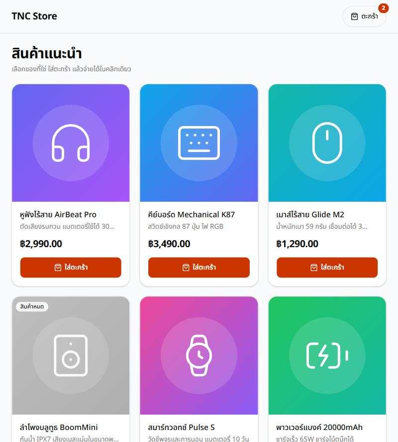
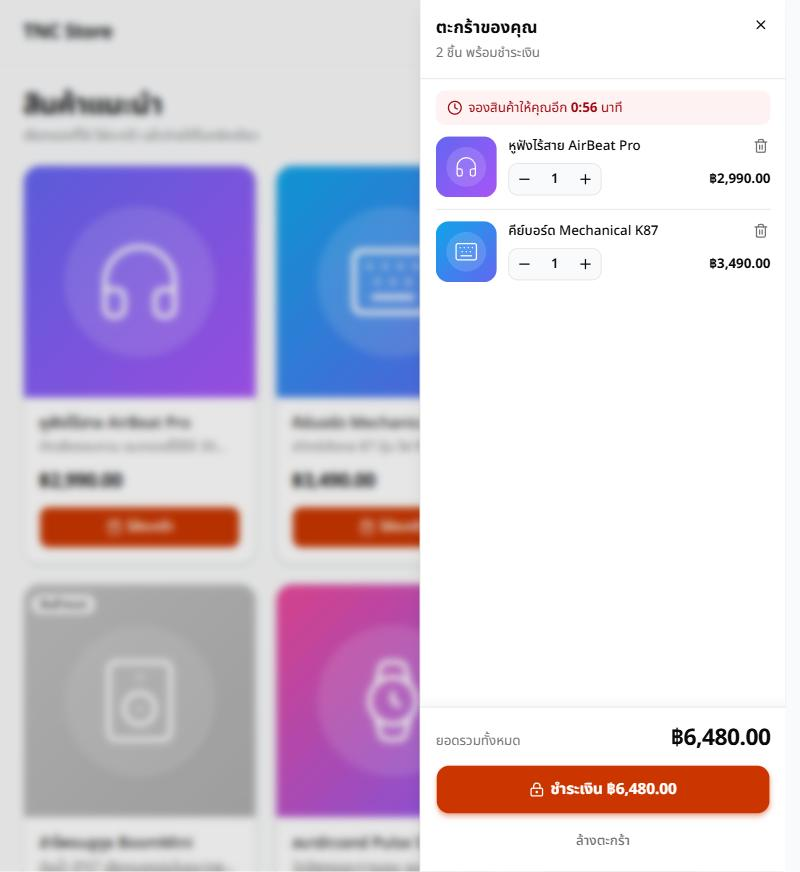
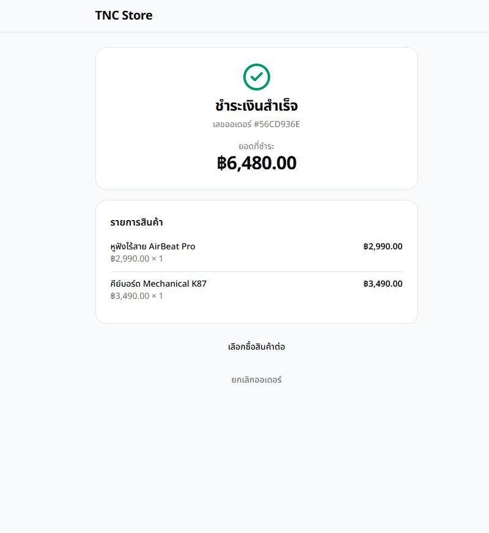
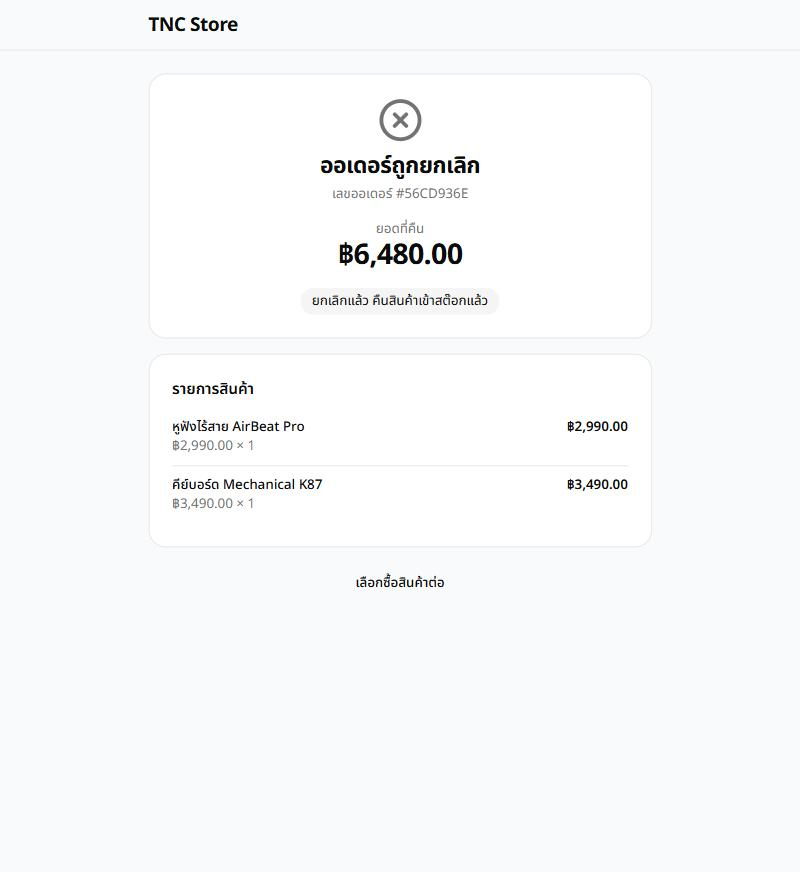
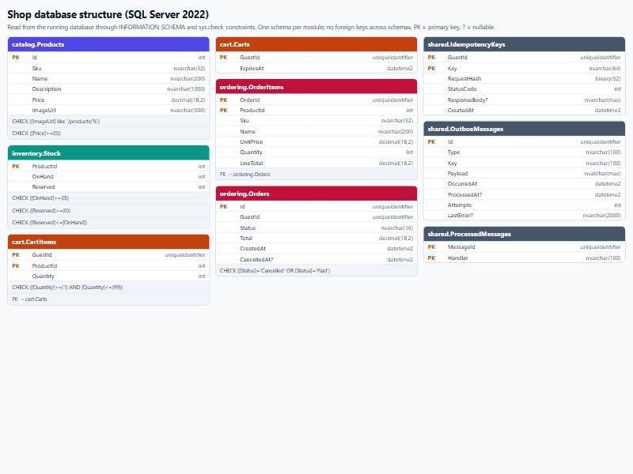

# TNC Store — ระบบร้านค้า สต๊อกสินค้า และตะกร้าสินค้า

ร้านค้าออนไลน์ที่ลูกค้าเลือกสินค้า ใส่ตะกร้า ชำระเงิน และยกเลิกออเดอร์ได้ โดยสต๊อกถูกต้องเสมอแม้มี request พร้อมกันจำนวนมาก

## เริ่มใช้งาน: clone แล้วรันคำสั่งเดียว

ต้องมีแค่ [Docker Desktop](https://www.docker.com/products/docker-desktop/) ที่เปิดอยู่ ไม่ต้องติดตั้ง .NET หรือ Node

```bash
git clone -b feat/shopping-cart <ที่อยู่ repo> tnc-store
```

```bash
cd tnc-store
```

```powershell
powershell -ExecutionPolicy Bypass -File scripts/up.ps1
```

เมื่อขึ้นข้อความ `Ready: http://localhost:3000` ให้เปิด http://localhost:3000 ได้เลย ครั้งแรกใช้เวลาหลายนาทีเพราะต้องดาวน์โหลด image ของ SQL Server และ Kafka

> ตัวเลือก `-b feat/shopping-cart` จำเป็นตราบที่โค้ดยังไม่ถูก merge เข้า `main` หลัง merge แล้วให้เอาออกจากคำสั่งและลบบรรทัดนี้ทิ้ง

**สิ่งที่คำสั่งนี้ทำ**

1. สร้างไฟล์ `.env` พร้อมรหัสผ่านแบบสุ่ม เฉพาะเมื่อยังไม่มีไฟล์นี้ (ถ้ามีอยู่แล้วจะไม่แก้)
2. build image ของ API และเว็บ
3. รัน SQL Server และ Kafka สร้างตาราง ใส่ข้อมูลสินค้าตัวอย่าง 12 รายการ แล้วรัน API กับเว็บ
4. รอจนระบบตอบได้จริง แล้วแจ้งที่อยู่ของหน้าเว็บ

**คำสั่งที่ใช้บ่อยหลังจากนั้น**

| ต้องการ | คำสั่ง |
|---|---|
| หยุดระบบ (ข้อมูลยังอยู่) | `docker compose --profile app down` |
| เริ่มใหม่หลังแก้โค้ด | รัน `scripts/up.ps1` ซ้ำ |
| ดู log | `docker compose --profile app logs -f api web` |
| ล้างทุกอย่างรวมถึงข้อมูลในฐานข้อมูล | `docker compose --profile app down -v` |

**ถ้าไม่สำเร็จ**

| อาการ | สาเหตุและวิธีแก้ |
|---|---|
| `docker compose failed. Is Docker Desktop running?` | เปิด Docker Desktop แล้วรอจนพร้อม จากนั้นรันใหม่ |
| ขั้นตอน `migrate` ล้มด้วย `Login failed for user 'sa'` | ไฟล์ `.env` ถูกสร้างใหม่ แต่ฐานข้อมูลเดิมยังใช้รหัสผ่านเก่า ใช้ `docker compose --profile app down -v` แล้วรันใหม่ (ข้อมูลเดิมจะหาย) |
| port 3000 ถูกใช้อยู่ | ปิดโปรแกรมที่ใช้ port 3000 หรือแก้เลข port ฝั่งซ้ายของ `127.0.0.1:3000:3000` ใน `docker-compose.yml` |
| ใช้ macOS หรือ Linux | สคริปต์นี้เป็น PowerShell สำหรับ Windows ให้ทำตามหัวข้อ "วิธีรัน" ข้อ 1 แทน |

| ส่วน | เทคโนโลยี |
|---|---|
| Frontend | Next.js 16 (App Router), Tailwind CSS, shadcn/ui |
| Backend | .NET 10 Minimal API, EF Core — modular monolith (Catalog, Inventory, Cart, Ordering) |
| ข้อมูล | SQL Server 2022 |
| Messaging | Apache Kafka (ทำงานคู่กับ Outbox pattern) |
| Deploy | Docker, Kubernetes (Kustomize), Traefik |

**เอกสารสำหรับผู้รับช่วงต่อ**

- [Spec การออกแบบ](docs/superpowers/specs/2026-10-06-shopping-cart-design.md) — เหตุผลของทุกการตัดสินใจ กฎของสต๊อก API ความปลอดภัย
- [โครงสร้างฐานข้อมูล](docs/database.md) — ตาราง คอลัมน์ ข้อบังคับ และแผนภาพ
- [แผนลงมือทำ](docs/superpowers/plans/2026-10-06-shopping-cart.md) — แบ่งงานเป็น 13 task พร้อม interface และ test ของแต่ละ task

## ภาพหน้าจอ

| รายการสินค้า | ตะกร้าสินค้า |
|---|---|
|  |  |

| ชำระเงินสำเร็จ | ยกเลิกออเดอร์และคืนสต๊อก |
|---|---|
|  |  |

โครงสร้างฐานข้อมูลอยู่ที่ [docs/database.md](docs/database.md)



## โครงสร้าง

```
backend/    Shop.slnx, src/ (Shop.Api + โมดูล 4 ตัว + Shop.Shared), tests/ (unit, integration)
frontend/   Next.js app, unit test อยู่ข้างไฟล์ที่ทดสอบ (*.test.ts, *.test.tsx)
deploy/k8s/ Kubernetes manifests
scripts/    ตัวช่วยรัน API ตอนพัฒนา
```

## สิ่งที่ต้องติดตั้ง

- Docker Desktop
- .NET SDK 10 และ Node.js 22 (เฉพาะเมื่อพัฒนาหรือรัน test)

## วิธีรัน

### 1. ทั้งระบบด้วย docker compose

ถ้ามีไฟล์ `.env` อยู่แล้ว (สคริปต์ข้างบนสร้างให้ หรือคัดลอกจาก `.env.example` แล้วใส่ค่าเอง) ใช้คำสั่งนี้ได้โดยตรง

```bash
docker compose --profile app up --build -d
```

เปิด http://localhost:3000 ขั้นตอน `migrate` จะสร้างตาราง ใส่ข้อมูลสินค้าตัวอย่าง 12 รายการ และสร้าง login `shop_app` ให้ API ใช้

ข้อควรรู้:

- **รหัสผ่าน SQL Server ถูกกำหนดตอนสร้าง volume ครั้งแรก** ถ้าเปลี่ยนค่าใน `.env` ภายหลัง ขั้นตอน `migrate` จะล้มด้วย "Login failed" วิธีเริ่มใหม่คือ `docker compose --profile app down -v` ซึ่ง **ลบข้อมูลในฐานข้อมูลทั้งหมด**
- **ไฟล์ `.env` ถูก git ignore** ห้าม commit
- **Rate limit นับรวมทุกคนเป็นลูกค้ารายเดียวในโหมดนี้** (ชำระเงินได้ 5 ครั้งต่อนาที) เพราะทุก request มาถึง API จาก container ของเว็บ ถ้าจะทดสอบโหลดให้เพิ่มค่า `RateLimit__CartPerMinute` และ `RateLimit__CheckoutPerMinute` ใน `docker-compose.yml`

### 2. โหมดพัฒนา

รันเฉพาะ SQL Server กับ Kafka ใน Docker แล้วรัน API กับเว็บบนเครื่อง

```bash
docker compose up -d
```

```bash
scripts/dev-api.sh migrate
```

```bash
scripts/dev-api.sh
```

```bash
npm --prefix frontend run dev
```

บน Windows PowerShell ใช้ `scripts/dev-api.ps1` แทน `scripts/dev-api.sh` API อยู่ที่ http://localhost:5080 เว็บอยู่ที่ http://localhost:3000

### 3. Kubernetes

ดู [deploy/k8s/README.md](deploy/k8s/README.md)

## การทดสอบ

| ชุด | คำสั่ง | ต้องใช้ Docker |
|---|---|---|
| Backend unit test | `dotnet test backend/tests/Shop.UnitTests` | ไม่ |
| Backend integration test | `dotnet test backend/tests/Shop.IntegrationTests` | ใช่ (สร้าง SQL Server และ Kafka ชั่วคราวเอง) |
| Frontend unit test | `npm --prefix frontend test` | ไม่ |
| Frontend ตรวจชนิดและ lint | `npm --prefix frontend run typecheck` และ `npm --prefix frontend run lint` | ไม่ |

Integration test ใช้ SQL Server และ Kafka จริง เพราะพฤติกรรมเรื่อง lock, transaction และการส่ง event ทดสอบด้วย mock ไม่ได้ ครอบคลุมกรณีเสี่ยงหลัก: ขายเกินสต๊อกเมื่อชนกัน, ชำระเงินซ้ำ, ยกเลิกซ้ำ, ตะกร้าหมดอายุ, SQL injection และสิทธิ์เข้าถึงออเดอร์ของคนอื่น

## API โดยย่อ

| Method | Path | ทำอะไร |
|---|---|---|
| GET | `/api/products` | รายการสินค้าพร้อมจำนวนคงเหลือ |
| GET | `/api/cart` | ตะกร้าปัจจุบัน |
| POST | `/api/cart/items` | เพิ่มสินค้า (ต้องมี header `Idempotency-Key`) |
| PUT | `/api/cart/items/{productId}` | ตั้งจำนวน |
| DELETE | `/api/cart/items/{productId}` | ลบรายการ |
| DELETE | `/api/cart` | ล้างตะกร้า |
| POST | `/api/orders` | ชำระเงิน (ต้องมี `Idempotency-Key`) |
| GET | `/api/orders/{id}` | ดูออเดอร์ |
| POST | `/api/orders/{id}/cancel` | ยกเลิกออเดอร์และคืนสต๊อก (ต้องมี `Idempotency-Key`) |

รายละเอียด รูปข้อมูล และรหัส error อยู่ใน spec ข้อ 8

## สิ่งที่ควรรู้ก่อนแก้โค้ด

- **สต๊อกเปลี่ยนด้วย `UPDATE` ที่มีเงื่อนไขคำสั่งเดียวเท่านั้น** แล้วตรวจจำนวนแถวที่ถูกแก้ (ดู `InventoryApi.cs`) ห้ามอ่านค่ามาคำนวณในโค้ดแล้วเขียนกลับ
- **โมดูลห้ามอ้างอิงกันโดยตรง** คุยกันผ่าน interface ใน `Shop.Shared/Contracts.cs` หรือ event ผ่าน outbox เท่านั้น และห้าม query ตารางของ schema อื่น
- **ห้ามใช้ `ExecuteSqlRaw`, `FromSqlRaw`, `dangerouslySetInnerHTML`, `innerHTML`, `eval`** มี test ที่ทำให้ build ล้มถ้าพบ
- **API ไม่รัน migration ตอนเริ่ม** ต้องรันคำสั่ง `migrate` แยก (compose และ Kubernetes ทำให้อัตโนมัติ)
- **เพิ่ม migration:** `dotnet ef migrations add <ชื่อ> -p src/Shop.<โมดูล> -s src/Shop.Api -c <โมดูล>DbContext` (รันใน `backend/`)
- **event ที่ประมวลผลไม่ได้** ถูกส่งไป topic `shop.events.dlq` ใน Kafka ควรตรวจ topic นี้เป็นระยะ
