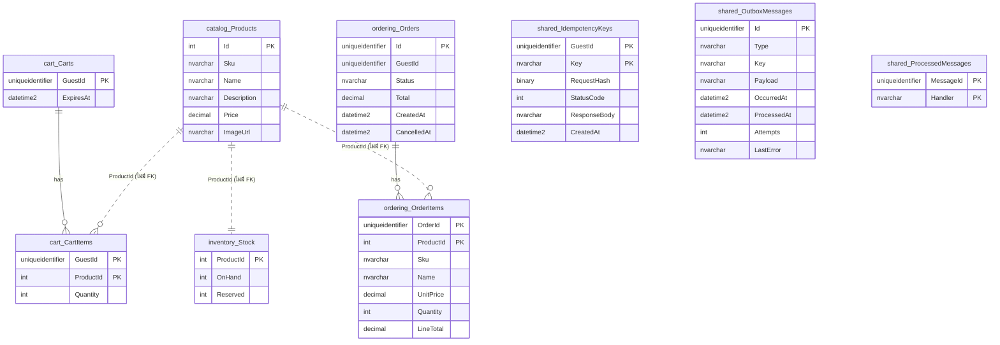

# โครงสร้างฐานข้อมูล

ฐานข้อมูล `Shop` บน SQL Server 2022 อ่านจากฐานข้อมูลที่รันจริงเมื่อ 2026-10-06 แต่ละโมดูลมี schema ของตัวเอง ไม่มี foreign key ข้าม schema เพื่อให้แยกโมดูลเป็น service ได้ภายหลัง

## แผนภาพ

เส้นประคือความสัมพันธ์เชิงตรรกะข้ามโมดูล ซึ่งตั้งใจไม่สร้าง foreign key

## schema `catalog`

ข้อมูลสินค้า (รหัส ชื่อ ราคาขายต่อหน่วย)

### catalog.Products

| คอลัมน์ | ชนิด | ว่างได้ | คีย์ |
|---|---|---|---|
| Id | `int` | ไม่ได้ | PK |
| Sku | `nvarchar(32)` | ไม่ได้ |  |
| Name | `nvarchar(200)` | ไม่ได้ |  |
| Description | `nvarchar(1000)` | ไม่ได้ |  |
| Price | `decimal(18,2)` | ไม่ได้ |  |
| ImageUrl | `nvarchar(300)` | ไม่ได้ |  |

ข้อบังคับ (CHECK):

- `([ImageUrl] like '/products/%')`
- `([Price]>=(0))`

## schema `inventory`

สต๊อกสินค้า: OnHand = ของที่ยังไม่ขาย, Reserved = ของที่อยู่ในตะกร้าลูกค้า, คงเหลือที่ขายได้ = OnHand − Reserved

### inventory.Stock

| คอลัมน์ | ชนิด | ว่างได้ | คีย์ |
|---|---|---|---|
| ProductId | `int` | ไม่ได้ | PK |
| OnHand | `int` | ไม่ได้ |  |
| Reserved | `int` | ไม่ได้ |  |

ข้อบังคับ (CHECK):

- `([OnHand]>=(0))`
- `([Reserved]>=(0))`
- `([Reserved]<=[OnHand])`

## schema `cart`

ตะกร้าสินค้าของ guest แต่ละคน หมดอายุหลังนิ่ง 15 นาที

### cart.CartItems

| คอลัมน์ | ชนิด | ว่างได้ | คีย์ |
|---|---|---|---|
| GuestId | `uniqueidentifier` | ไม่ได้ | PK |
| ProductId | `int` | ไม่ได้ | PK |
| Quantity | `int` | ไม่ได้ |  |

ข้อบังคับ (CHECK):

- `([Quantity]>=(1) AND [Quantity]<=(99))`

Foreign key: `GuestId`/`OrderId` → `cart.Carts` (ลบตามเมื่อแถวแม่ถูกลบ)

### cart.Carts

| คอลัมน์ | ชนิด | ว่างได้ | คีย์ |
|---|---|---|---|
| GuestId | `uniqueidentifier` | ไม่ได้ | PK |
| ExpiresAt | `datetime2` | ไม่ได้ |  |

## schema `ordering`

ออเดอร์ที่ชำระเงินแล้วหรือถูกยกเลิก

### ordering.OrderItems

| คอลัมน์ | ชนิด | ว่างได้ | คีย์ |
|---|---|---|---|
| OrderId | `uniqueidentifier` | ไม่ได้ | PK |
| ProductId | `int` | ไม่ได้ | PK |
| Sku | `nvarchar(32)` | ไม่ได้ |  |
| Name | `nvarchar(200)` | ไม่ได้ |  |
| UnitPrice | `decimal(18,2)` | ไม่ได้ |  |
| Quantity | `int` | ไม่ได้ |  |
| LineTotal | `decimal(18,2)` | ไม่ได้ |  |

Foreign key: `GuestId`/`OrderId` → `ordering.Orders` (ลบตามเมื่อแถวแม่ถูกลบ)

### ordering.Orders

| คอลัมน์ | ชนิด | ว่างได้ | คีย์ |
|---|---|---|---|
| Id | `uniqueidentifier` | ไม่ได้ | PK |
| GuestId | `uniqueidentifier` | ไม่ได้ |  |
| Status | `nvarchar(16)` | ไม่ได้ |  |
| Total | `decimal(18,2)` | ไม่ได้ |  |
| CreatedAt | `datetime2` | ไม่ได้ |  |
| CancelledAt | `datetime2` | ได้ |  |

ข้อบังคับ (CHECK):

- `([Status]='Cancelled' OR [Status]='Paid')`

## schema `shared`

โครงสร้างพื้นฐาน: Outbox (event ที่รอส่งเข้า Kafka), กันประมวลผล event ซ้ำ, และ Idempotency key

### shared.IdempotencyKeys

| คอลัมน์ | ชนิด | ว่างได้ | คีย์ |
|---|---|---|---|
| GuestId | `uniqueidentifier` | ไม่ได้ | PK |
| Key | `nvarchar(64)` | ไม่ได้ | PK |
| RequestHash | `binary(32)` | ไม่ได้ |  |
| StatusCode | `int` | ไม่ได้ |  |
| ResponseBody | `nvarchar(max)` | ได้ |  |
| CreatedAt | `datetime2` | ไม่ได้ |  |

### shared.OutboxMessages

| คอลัมน์ | ชนิด | ว่างได้ | คีย์ |
|---|---|---|---|
| Id | `uniqueidentifier` | ไม่ได้ | PK |
| Type | `nvarchar(100)` | ไม่ได้ |  |
| Key | `nvarchar(100)` | ไม่ได้ |  |
| Payload | `nvarchar(max)` | ไม่ได้ |  |
| OccurredAt | `datetime2` | ไม่ได้ |  |
| ProcessedAt | `datetime2` | ได้ |  |
| Attempts | `int` | ไม่ได้ |  |
| LastError | `nvarchar(2000)` | ได้ |  |

### shared.ProcessedMessages

| คอลัมน์ | ชนิด | ว่างได้ | คีย์ |
|---|---|---|---|
| MessageId | `uniqueidentifier` | ไม่ได้ | PK |
| Handler | `nvarchar(100)` | ไม่ได้ | PK |

